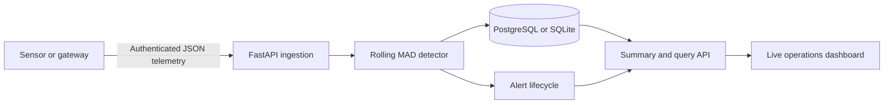

# SensorWatch

[](https://github.com/amkumirab/SensorWatch/actions/workflows/tests.yml)
[](https://www.python.org/)
[](LICENSE)

SensorWatch is a compact industrial telemetry MVP. It accepts sensor readings through a
FastAPI service, stores them in PostgreSQL or SQLite, builds an independent rolling baseline
for every sensor/metric pair, and flags unusual values in a live monitoring dashboard.

The detector uses the median and median absolute deviation (MAD), making it more robust to
spikes than a mean and standard-deviation baseline. Every decision includes an anomaly score,
baseline center, and baseline scale so the result remains explainable.

> **Project status:** Portfolio MVP. It demonstrates ingestion, online detection, persistence,
> API design, testing, and containerization; it is not a certified industrial alarm system.

## Features

- Single and batch telemetry ingestion
- Optional API key authentication for telemetry ingestion
- Independent rolling baselines per sensor and metric
- Robust MAD anomaly scoring with warm-up state
- PostgreSQL and SQLite persistence managed with Alembic migrations
- Transactional alert creation with acknowledge and resolve workflows
- Per-sensor limits and detection sensitivity with historical rule snapshots
- Dashboard rule editor with validation and temporary API key entry
- Server-receipt-based stream connectivity monitoring with per-series timeouts
- Summary, fleet, telemetry, and anomaly APIs
- Responsive dependency-free monitoring dashboard
- Deterministic three-sensor demo-data generator
- OpenAPI documentation at `/docs`
- Unit and API integration tests
- Docker and GitHub Actions configuration

## Architecture



For each reading, SensorWatch loads the most recent values from the same sensor/metric series.
It waits for a configurable warm-up period, calculates a robust baseline, persists the decision,
and returns the anomaly metadata in the ingestion response.

## Quick start

Requirements: Python 3.10 or newer.

Windows PowerShell:

```powershell
py -m venv .venv
.venv\Scripts\Activate.ps1
python -m pip install -e ".[dev]"
sensorwatch migrate
sensorwatch
```

macOS or Linux:

```bash
python -m venv .venv
source .venv/bin/activate
python -m pip install -e ".[dev]"
sensorwatch migrate
sensorwatch
```

Open <http://127.0.0.1:8000>. Press **Generate demo data** to create temperature,
vibration, and pressure telemetry with a few injected faults.

The local default is SQLite, which keeps the quick start self-contained. Database changes are
applied through Alembic before the service starts.

## Run with Docker and PostgreSQL

```bash
docker compose up --build
```

Docker Compose starts PostgreSQL, waits for its health check, applies all migrations, and then
starts SensorWatch. The named PostgreSQL volume preserves telemetry between container restarts.
The default credentials are intended for local development; override them in a local `.env`
file before using the stack outside a development machine.

## Database migrations

Apply every pending migration to the database selected by `SENSORWATCH_DATABASE_URL`:

```bash
sensorwatch migrate
```

The command accepts SQLite, `postgresql://`, `postgres://`, and explicit
`postgresql+psycopg://` URLs. Common hosted PostgreSQL URL formats are normalized to the
psycopg 3 driver automatically.

To create a migration after changing the SQLAlchemy models:

```bash
alembic revision --autogenerate -m "Describe the schema change"
alembic upgrade head
```

The initial migration creates the telemetry table and all query indexes. Migration behavior is
tested against SQLite on every supported Python version and against a real PostgreSQL service
in GitHub Actions.

## Alert workflow

Every anomalous reading creates one alert in the same database transaction. Alerts start in
the `open` state, must be acknowledged by an operator, and can then be resolved. Repeating the
same action is safe, while an invalid state transition returns HTTP `409 Conflict`.

Severity is derived from the anomaly score: readings at least twice the configured detector
threshold are `critical`; other anomalies are `warning`. The dashboard shows active alerts and
lets an operator acknowledge or resolve them without leaving the monitoring view.

## Per-sensor alert rules

In the dashboard, select a sensor series and use **Sensor alert rule** to view, save,
or delete its settings. Blank bounds mean no limit; a blank detection threshold uses the
global default. Deletion requires confirmation and restores the global detection settings.
Automatic dashboard refreshes preserve unsaved edits for the selected series. Switching
to another series or pressing **Reload rule** discards those edits and loads the saved rule.

For protected installations, enter the ingestion key in the **API key** field. It is used
for write requests, including demo generation, and is never stored in browser storage or
URLs. Reloading or leaving the page clears it; **Clear key** removes it immediately.
Use HTTPS when accessing a remote installation.

Create or replace a rule for a sensor/metric pair:

```bash
curl -X PUT http://127.0.0.1:8000/api/v1/rules/boiler-01/temperature \
  -H "Content-Type: application/json" \
  -H "X-API-Key: $SENSORWATCH_INGEST_API_KEY" \
  -d '{"lower_bound": 10, "upper_bound": 80, "detector_threshold": 5}'
```

All settings are optional and accept `null`. Omitted settings are cleared by `PUT`;
this replaces the complete rule. Bounds must be finite, lower must be less than upper,
and the detector threshold must be finite and positive. A larger threshold reduces sensitivity.

Values strictly below or above a configured bound create a critical alert immediately,
including during detector warm-up. Values exactly at a bound are allowed, but can still
trigger the independent MAD detector after warm-up. A custom threshold replaces the global
MAD threshold only for the matching sensor and metric; otherwise the global value applies.

`GET /api/v1/rules` lists rules with `limit` (default 100, maximum 500) and `offset`.
Use `GET` or `DELETE /api/v1/rules/{sensor_id}/{metric}` to retrieve or remove one rule.
Missing rules return `404`. Rule changes and deletion require `X-API-Key` when configured.

Detection changes affect only future ingestion. Each reading includes an `applied_rule` snapshot
with the effective detection settings, so past decisions remain explainable after a rule is edited or deleted.
Readings without a custom rule, including existing records, return `applied_rule: null`.
Apply the new schema with `sensorwatch migrate` before restarting an existing installation.

## Stream connectivity

The fleet shows **Online** or **Stale** for each sensor/metric pair, its last server receipt
time, and the effective silence timeout. The system-status card counts stale streams.
The global timeout is 300 seconds; set `SENSORWATCH_STALE_AFTER_SECONDS` to change it.
In the rule editor, **Stale after (seconds)** overrides that timeout for the selected pair:

```json
{"stale_after_seconds": 60}
```

Send this setting with `PUT /api/v1/rules/{sensor_id}/{metric}` alongside any detection
settings you want to retain. It must be a whole number from 1 to 604800 (seven days).
`null`, omission, or deleting the rule restores the global timeout. Timeout changes apply
to the current stream status immediately; they do not change historical anomaly snapshots.

`GET /api/v1/sensors` includes `last_received_at`, `connectivity_status`, and the effective
`stale_after_seconds`. `GET /api/v1/summary` includes `stale_series`; the existing
`active_series` still counts all known series, including stale ones.

A stream becomes stale only when the elapsed time is **greater than** its timeout; at the
exact boundary it is still online. Receipt time comes from the server's `created_at`,
not the device's `recorded_at`. New arrivals restore online status even when they contain
historical samples. Only series with at least one received reading are monitored.
Server clocks should be synchronized; negative elapsed time after a clock adjustment is
treated as zero.

Status is computed when queried and appears on the dashboard's next 10-second refresh.
This feature does not create persistent alert records or send background notifications.
For a stale stream, check gateway connectivity and recent ingestion errors first, then verify
that its timeout matches the expected sampling interval. Run `sensorwatch migrate` before
starting this version against an existing database.

## Send a reading

Ingestion authentication is disabled by default for local development. To enable it, generate
a strong key and set `SENSORWATCH_INGEST_API_KEY` before starting the service:

```powershell
$env:SENSORWATCH_INGEST_API_KEY = py -c "import secrets; print(secrets.token_urlsafe(32))"
```

```bash
export SENSORWATCH_INGEST_API_KEY="$(python -c 'import secrets; print(secrets.token_urlsafe(32))')"
```

When authentication is enabled, send the same key in the `X-API-Key` header. SensorWatch keeps
only a SHA-256 fingerprint in application settings and uses a constant-time comparison.

```bash
curl -X POST http://127.0.0.1:8000/api/v1/readings \
  -H "Content-Type: application/json" \
  -H "X-API-Key: $SENSORWATCH_INGEST_API_KEY" \
  -d '{
    "sensor_id": "boiler-01",
    "metric": "temperature",
    "value": 72.4,
    "unit": "C"
  }'
```

Example response:

```json
{
  "id": 1,
  "sensor_id": "boiler-01",
  "metric": "temperature",
  "value": 72.4,
  "unit": "C",
  "recorded_at": "2026-08-14T08:30:00Z",
  "anomaly_score": 0.0,
  "is_anomaly": false,
  "detector_status": "warming-up",
  "baseline_center": null,
  "baseline_scale": null
}
```

See the interactive OpenAPI page for batch ingestion and query filters:
<http://127.0.0.1:8000/docs>.

## Detector configuration

Copy `.env.example` or set environment variables before starting the service.

| Variable | Default | Purpose |
|---|---:|---|
| `SENSORWATCH_DATABASE_URL` | `sqlite:///./data/sensorwatch.db` | SQLAlchemy database URL |
| `SENSORWATCH_DETECTOR_WINDOW` | `40` | Recent samples in each baseline |
| `SENSORWATCH_DETECTOR_MIN_SAMPLES` | `12` | Warm-up samples before classification |
| `SENSORWATCH_DETECTOR_THRESHOLD` | `3.5` | Minimum robust score for an anomaly |
| `SENSORWATCH_DEMO_ENABLED` | `true` | Enable the demo-data endpoint |
| `SENSORWATCH_INGEST_API_KEY` | unset | Protect ingestion, demo generation, and rule mutations with `X-API-Key` |
| `SENSORWATCH_STALE_AFTER_SECONDS` | `300` | Global stream silence timeout, from 1 to 604800 seconds |

## Development

```bash
ruff check .
pytest --cov=sensorwatch --cov-report=term-missing
```

Run the browser tests against a temporary database and isolated Chromium:

```bash
python -m pip install -e ".[dev,browser]"
python -m playwright install chromium
pytest browser_tests
```

The browser suite checks rule creation, updates, deletion, authentication errors,
validation, sensor selection, refresh behavior, connectivity recovery, and responsive layouts.

Install PostgreSQL support for development with:

```bash
python -m pip install -e ".[dev,postgres]"
```

## API overview

| Method | Path | Purpose |
|---|---|---|
| `POST` | `/api/v1/readings` | Ingest one reading; API key protected when configured |
| `POST` | `/api/v1/readings/batch` | Ingest up to 500 readings atomically; API key protected when configured |
| `GET` | `/api/v1/readings` | Query telemetry and anomalies |
| `GET` | `/api/v1/summary` | Retrieve operational totals |
| `GET` | `/api/v1/sensors` | List sensor/metric series |
| `GET` | `/api/v1/alerts` | Query alerts by state or severity |
| `GET` | `/api/v1/rules` | List per-series alert rules |
| `GET` | `/api/v1/rules/{sensor_id}/{metric}` | Retrieve one rule |
| `PUT` | `/api/v1/rules/{sensor_id}/{metric}` | Create or replace a rule; API key protected when configured |
| `DELETE` | `/api/v1/rules/{sensor_id}/{metric}` | Remove a rule; API key protected when configured |
| `POST` | `/api/v1/alerts/{id}/acknowledge` | Acknowledge an open alert |
| `POST` | `/api/v1/alerts/{id}/resolve` | Resolve an acknowledged alert |
| `POST` | `/api/v1/demo/generate` | Generate reproducible demo telemetry; API key protected when configured |
| `GET` | `/health` | Database-backed health check |

## Production roadmap

- Optional TimescaleDB hypertables for long-running telemetry stores
- Redis Streams or Kafka ingestion workers
- Per-device keys, key rotation, and per-tenant access control
- Configurable alert rules and escalation policies
- Prometheus metrics and OpenTelemetry traces
- Drift detection and scheduled model retraining
- WebSocket updates rather than dashboard polling

## Limitations

- The MVP runs detection inline with ingestion.
- A late historical reading is scored against the latest stored baseline.
- SQLite remains useful for a local demonstration; PostgreSQL is recommended for concurrent
  ingestion and container deployments.
- The demo endpoint should be disabled in a public production deployment.
- Authentication currently uses one shared ingestion key. Read and alert-management endpoints
  should remain behind a trusted network or an authenticating reverse proxy.
- The rule editor configures sensor series that already have telemetry; use the API to
  prepare rules for a sensor before its first reading.

## Contributing

Bug reports, focused pull requests, and discussions about detector behavior are welcome. Read
[CONTRIBUTING.md](CONTRIBUTING.md) before submitting a change. Security reports should follow
the private process described in [SECURITY.md](SECURITY.md).

## Author

Created and maintained by
[AmirAli Mirabzadeh Ardekani](https://github.com/amkumirab).

## License

[MIT](LICENSE)
